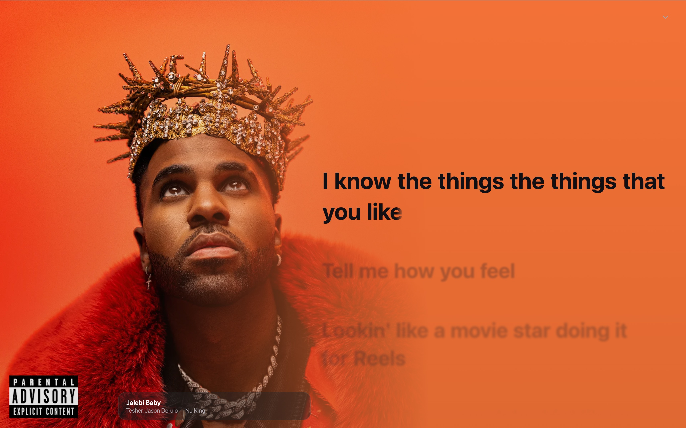
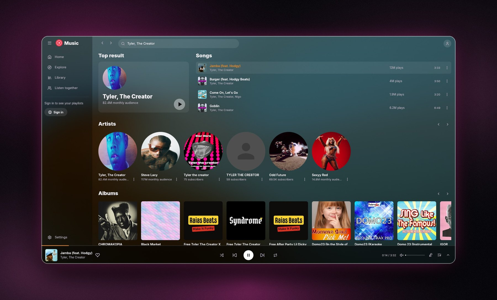
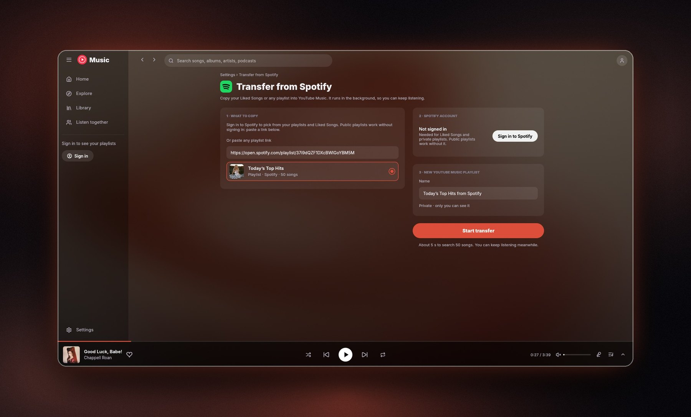
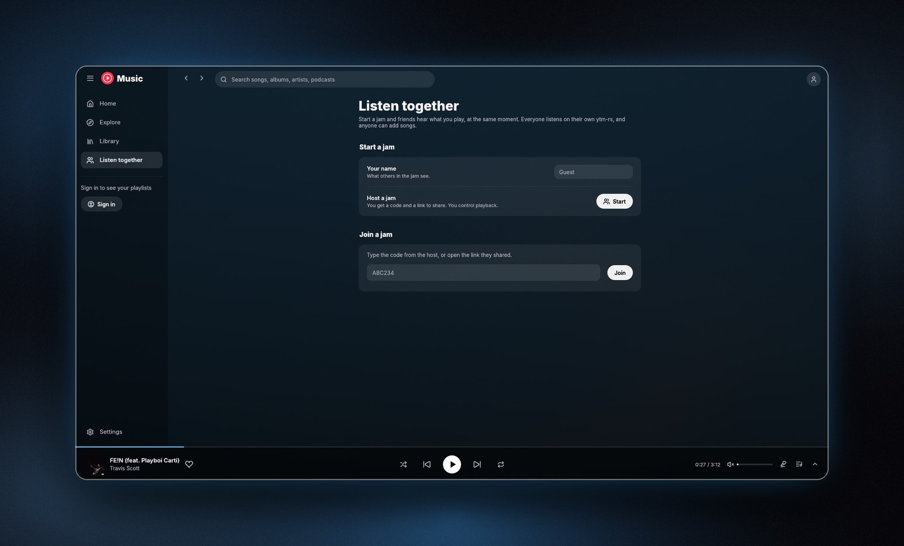

<div align="center">
  
  <h1>Dawn FM</h1>
  <p><strong>This isn't another Spotify clone or web wrapper.</strong></p>
  <p>A ground-up native desktop music player for YouTube Music &amp; Spotify — combining flagship optical design, ad-free cross-platform streaming, DJ mixing, Hi-Res &amp; Dolby Atmos audio, and word-synced karaoke in one lightweight Rust app.</p>

  <p>
    <a href="https://github.com/wenujacodes/DawnFM/releases/latest"></a>
    <a href="https://github.com/wenujacodes/DawnFM/releases"></a>
    
    <a href="LICENSE"></a>
  </p>

  <p>
    <a href="https://github.com/wenujacodes/DawnFM/releases/latest"><b>Download Dawn FM</b></a> ·
    <a href="#not-your-typical-music-app">Why Dawn FM</a> ·
    <a href="#more-than-press-play">Audio &amp; Visuals</a> ·
    <a href="#installation">Install</a> ·
    <a href="#build-from-source">Build</a>
  </p>
</div>

---

<table>
  <tr>
    <td width="50%"></td>
    <td width="50%"></td>
  </tr>
</table>

## Not Your Typical Music App

Most desktop music players force a compromise. Official apps feel like slow, cluttered browser windows full of podcasts, upsells, and ads. Third-party players usually skin an embedded webpage or lock you inside one ecosystem.

**Dawn FM doesn't wrap a website.** It is written from scratch in pure Rust with its own GPU shader renderer and dedicated audio engine — built to feel like a flagship desktop instrument rather than a browser tab.

- **Use Spotify and YouTube Music on your terms**: Stream **YouTube Music** instantly with no login required, sign in with Google for your personal feed and library, or connect your **Spotify** account (Free or Premium) for ad-free playback of your playlists, Liked Songs, albums, artists, and Radio mixes.
- **No podcasts, no clutter, no tracking**: Every surface is built strictly around music — with zero telemetry, zero ads, and credentials encrypted inside your macOS Login Keychain or Windows Credential Manager.
- **Flagship design that actually runs live**: Instead of flat translucent boxes, Dawn FM captures the real frame behind floating bars, menus, toggles, and overlays to render true optical **Liquid Glass** with edge refraction, animated **Apple Music motion covers**, handwritten artist signatures, and fluid **Kawarp** shader backdrops.

---

## More Than Press Play

### Sound That Stock Clients Can't Give You
- **Lossless Hi-Res & Dolby Atmos**: Connect a compatible Hi-Res audio addon for `LOSSLESS` playback (with seamless YouTube fallback), and decode DASH Dolby Atmos tracks natively on both macOS and Windows.
- **DJ Automix & Smart Crossfade**: Dawn FM reads track tempo (BPM) and musical key to blend songs together with beat-aware Automix transitions, repeat/flanger transition effects, loudness normalization, and smooth logarithmic volume control.
- **Skip the Filler Automatically**: Built-in **SponsorBlock** jumps straight past non-music intros, skits, and sponsor breaks in music videos while leaving studio tracks untouched.
- **Keep Songs Offline**: Download tracks as tagged `.m4a` audio with artwork so your music keeps playing without an internet connection.

### Lyrics & Visuals That React to Every Song
- **Word-by-Word Karaoke**: Syllable- and word-synced lyrics highlight smoothly as the track plays, complete with inline translations, romanization, and per-song timing adjustments (`±0.1s`).
- **Works Across Languages & Scripts**: Pulls official Spotify and YouTube Music lyrics first and automatically checks fallback sources for regional catalogs — with proper Sinhala support and right-to-left shaping for Arabic and Hebrew.
- **Make It Look Like Yours**: Switch between built-in Better Lyrics-inspired theme presets, vinyl spinning-record sleeves, custom accent colors, optional blurred Home backdrops, and auto-contrast ink over bright artwork.

### Switch Platforms or Listen Together — Built Right In
- **Spotify → YouTube Music Transfer**: Copy your Spotify Liked Songs and public or private playlists directly into YouTube Music without leaving the app or stopping playback, complete with match verification.
- **Listen Together (Jam)**: Spin up a shared listening room with a link so friends stay synced to the exact same song and timestamp.

### Designed to Live Beside Your Work
- **Always-on-Top Mini Player (`⌥⌘M`)**: Collapse the app into a slim floating strip that remembers where you put it.
- **Native OS Touches Everywhere**: macOS vibrancy, Dock playback controls, native macOS Share sheets, Windows frameless window controls & system tray minimize, Sleep Timer, Discord Rich Presence, Last.fm scrobbling (with offline queue), 5 UI languages, and automatic GitHub updates.

---

## Gallery

<table>
  <tr>
    <td width="50%"><br><sub>Dedicated Search, Browse Categories &amp; Top Results</sub></td>
    <td width="50%"><br><sub>Built-in Spotify → YouTube Music Transfer</sub></td>
  </tr>
  <tr>
    <td width="50%"><br><sub>Liquid Glass, Kawarp Shaders &amp; Theme Presets</sub></td>
    <td width="50%"><br><sub>Synced Listen Together Rooms (Jam)</sub></td>
  </tr>
</table>

---

## Installation

Grab the latest release from **[GitHub Releases](https://github.com/wenujacodes/DawnFM/releases/latest)**:

| Platform | Download | Notes |
|---|---|---|
| **macOS** (Apple Silicon & Intel) | `DawnFM-*-macos-arm64.dmg` / `x64.dmg` | Drag **Dawn FM** into Applications. On first launch of an ad-hoc build, right-click → **Open** (or click *Open Anyway* in System Settings). |
| **Windows** (x64) | `DawnFM-*-windows-x64-setup.exe` or `portable.zip` | If Windows SmartScreen warns on the `.exe` or `.zip`, open **Properties** → check **Unblock** → **OK** (or *More info* → *Run anyway*). |

## Build from Source

Requires the Rust toolchain (`stable`). No Electron or Chromium runtime required:

```sh
git clone https://github.com/wenujacodes/DawnFM.git && cd DawnFM
cargo build --release
sh macos/bundle.sh target/release/dawnfm 2.6.0 out
open "out/Dawn FM.app"
```

## Credits

- App icon: **[@RamiruWanigathunga](https://github.com/RamiruWanigathunga)**
- Upstream base: [BitChord-PC-Continued](https://github.com/jackychan4891/BitChord-PC-Continued) by **[jackychan4891](https://github.com/jackychan4891)**
- License: [GNU General Public License v3.0](LICENSE)
