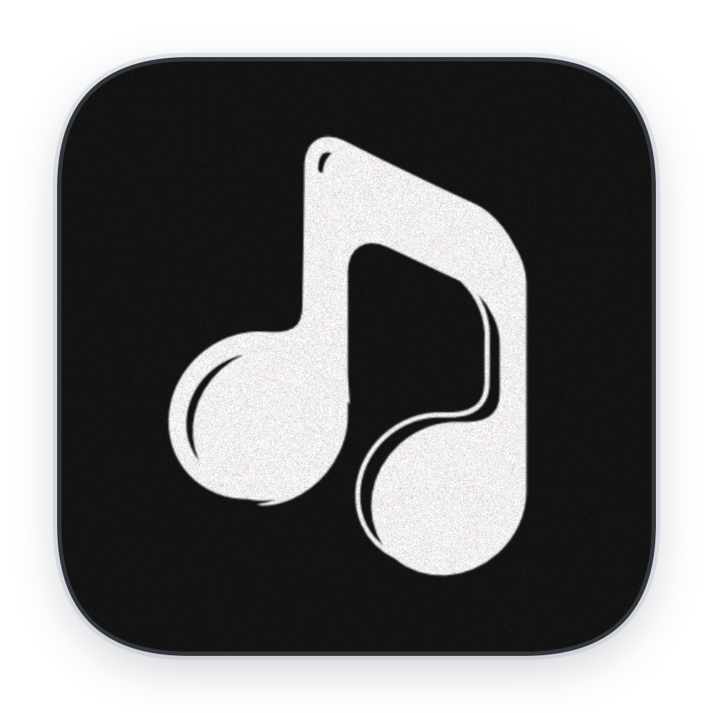
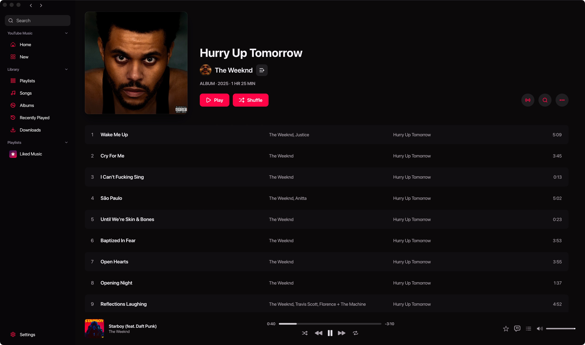

<div align="center">
  
  <h1>Dawn FM</h1>
  <p><strong>A fast, lightweight native YouTube Music &amp; Spotify player for macOS &amp; Windows</strong></p>
  <p>Pure Rust · No Electron · Frosted glass UI · 120 FPS animations · Ultra-low memory</p>

  <p>
    <a href="https://github.com/wenujacodes/DawnFM/releases/latest"></a>
    <a href="https://github.com/wenujacodes/DawnFM/releases"></a>
    
    <a href="LICENSE"></a>
  </p>

  <p>
    <a href="https://github.com/wenujacodes/DawnFM/releases/latest"><b>Download Releases</b></a> ·
    <a href="#key-features">Features</a> ·
    <a href="#installation">Install</a> ·
    <a href="#build-from-source">Build</a>
  </p>
</div>

---

<table>
  <tr>
    <td width="50%"></td>
    <td width="50%"></td>
  </tr>
</table>

## Key Features

- **YouTube Music & Spotify**: Start listening to YouTube Music right away without signing in, sign in with Google for your personal feed and library, or connect your **Spotify** account (Free & Premium, ad-free) via browser login, Email Code, or password.
- **Native & Ultra-Fast**: Built in Rust with [egui](https://github.com/emilk/egui) and [rodio](https://github.com/RustAudio/rodio). Instant playback, frosted glass visuals, near-zero idle resource usage, and smooth 120 FPS animations.
- **Cross-Platform**: First-class support for **macOS** (Apple Silicon & Intel vibrancy/Liquid Glass) and **Windows** (frameless custom titlebar, installer & portable zip).
- **Karaoke Lyrics**: Timed syllable-by-syllable synchronized lyrics (including Spotify & Hi-Res sources) with artwork-adaptive blur and typography.
- **Hi-Res Audio & Automix**: Lossless & Dolby Atmos addon playback, DJ automix, and seamless crossfade.
- **Playlist Transfer & Offline Mode**: Copy your Spotify Liked Songs and playlists to YouTube Music, download tracks offline, and enjoy an auto-hiding full-screen player.
- **Privacy First**: Zero telemetry, no analytics, direct service connections, and credentials encrypted in your macOS Keychain / Windows Credential Manager.

## Installation

Download the latest version from **[GitHub Releases](https://github.com/wenujacodes/DawnFM/releases/latest)**:

| Platform | Download | Note |
|---|---|---|
| **macOS** | `.dmg` (ARM64 / x64) | Drag to Applications. If prompted, click *Open Anyway* in System Settings. |
| **Windows** | Setup `.exe` or Portable `.zip` | If SmartScreen appears, click *More info* → *Run anyway* (or file Properties → Unblock). |

## Build from Source

```sh
git clone https://github.com/wenujacodes/DawnFM.git && cd DawnFM
cargo build --release
sh macos/bundle.sh target/release/dawnfm 2.6.0 out
```

## Credits

- App icon: **[@RamiruWanigathunga](https://github.com/RamiruWanigathunga)**
- Upstream base: [BitChord-PC-Continued](https://github.com/jackychan4891/BitChord-PC-Continued) by **[jackychan4891](https://github.com/jackychan4891)**
- Licensed under [GPL-3.0](LICENSE)
